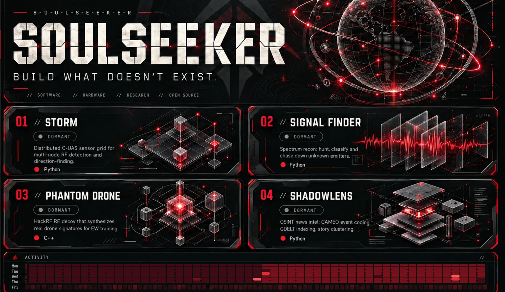
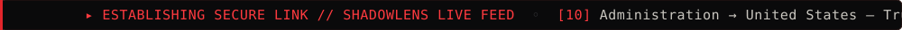
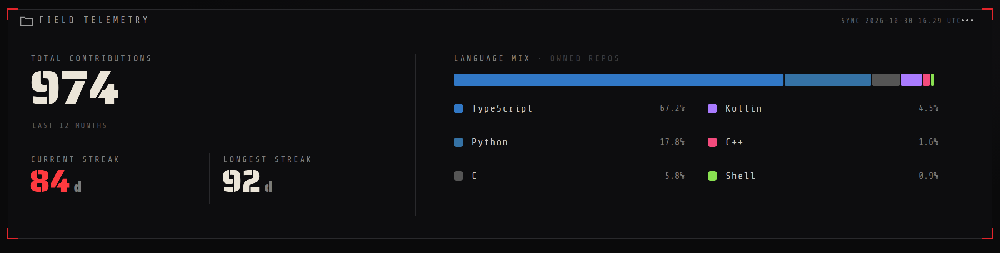
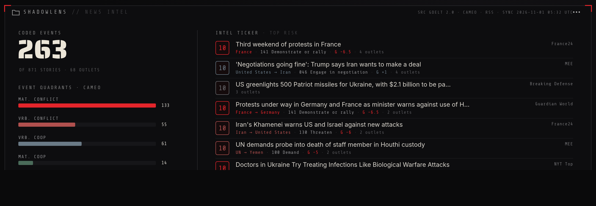

<!-- ░▒▓ SOULSEEKER // CLASSIFIED DEVELOPER PROFILE ▓▒░ -->

<div align="center">

<a href="https://github.com/S-O-U-L-S-E-E-K-E-R?tab=repositories"></a>



</div>

---

```
$ whoami
SoulSeeker — DevOps engineer · penetration tester · red teamer. I build the tooling.

focus   offensive security · red team · RF / SIGINT · drone detection (C-UAS) · OSINT
stack   Docker · Linux · CI/CD · Python · Bash · Kotlin/Android · C++ · HackRF · B210 · KrakenSDR
now     STORM (C-UAS sensor grid) · phantom-drone (RF decoy) · ShadowLens (news intel)
```

### ▞ DOSSIER LINKS

[](https://github.com/S-O-U-L-S-E-E-K-E-R/Signal-Finder)
&nbsp;


### ▞ MORE OPS &nbsp;`// PUBLIC`

[](https://github.com/S-O-U-L-S-E-E-K-E-R/The-Church-of-the-Machines)
[](https://github.com/S-O-U-L-S-E-E-K-E-R/Auto-Commiter-Bot)
[](https://github.com/S-O-U-L-S-E-E-K-E-R/Multi_Universal_Gravity_Simulation)
[](https://github.com/S-O-U-L-S-E-E-K-E-R?tab=repositories)

---

### ▞ WEAPONS LOCKER


`SDR` · `HackRF` · `USRP B210` · `KrakenSDR` · `DroneID` · `OFDM/LoRa/FHSS` · `Direction-Finding` · `Mesh` · `Hailo-8 ML`

---

### ▞ FIELD TELEMETRY

<div align="center">



</div>

---

### ▞ SHADOWLENS &nbsp;`// LIVE NEWS INTEL`

<div align="center">



</div>

---

### ▞ ACTIVITY LOG &nbsp;`// LIVE CONTRIBUTIONS`

<div align="center">


</div>

---

<div align="center">

```
“ The spectrum is a battlefield. Most people just can't see it. ”
```

`// end transmission`

</div>
